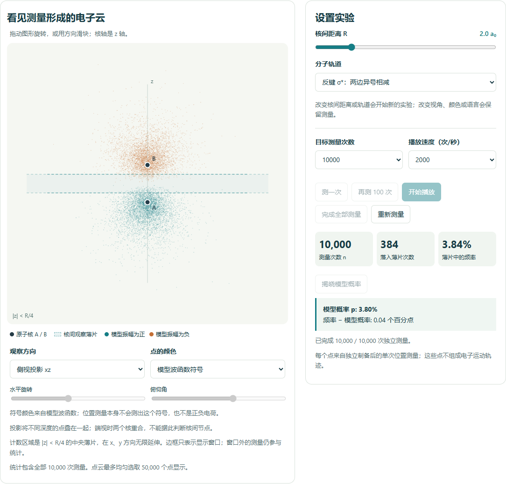

# Quantum Classroom

**Interactive probability, atomic orbitals, and molecular orbitals for university teaching.**

[简体中文](README.zh-CN.md) · [Model notes](docs/MODELS.md) · [Contributing](CONTRIBUTING.md)

One measurement gives a point. Repeated independent measurements reveal a distribution.

Quantum Classroom includes Electron Cloud Classroom, a bilingual teaching tool built with AI assistance, and native Python atomic and H₂⁺ laboratories. Students can predict, simulate position measurements, compare observed frequencies with model probabilities, and explain what they see. The existing web edition runs entirely in the browser and works offline.



## Try it locally

1. Download this repository using **Code → Download ZIP**, then extract it, or clone it with Git.
2. Open **[index.html](index.html)** in a recent Edge, Chrome, or Firefox browser.
3. Choose **Atomic orbitals** or **Molecular orbitals · H₂⁺**. Use **中文 / English** to change language.

No installation, account, local server, or internet connection is needed to use the app. `electron-cloud-classroom.html` is the same standalone application under a descriptive filename. Opening an HTML file on GitHub displays its source; download it to run it locally.

## What you can explore

### Python desktop preview · atoms and H₂⁺

The desktop edition provides a GUI-independent NumPy core and an optional native
PySide6 interface. It now includes all 30 hydrogen spatial orbitals (1s–4f),
Slater-screened orbitals and spherical whole-atom mixtures for 118 elements, plus
the existing H₂⁺ laboratory. Z=93–118 are explicitly ideal-filling illustrations,
not observed ground states. Switching laboratories pauses playback and preserves
both experiments. Full classroom activities and teacher presets remain in the web
edition pending a later migration stage.

Both workspaces support unbounded seeded sampling, all-measurement statistics,
rotation/projections, frequency and radial/axial curves, Chinese/English and
JSON exports. See [phase 2 results](docs/PHASE2_VALIDATION.md).

After installing the Linux system dependencies in the
[English installation guide](docs/LINUX_PYTHON.md) or
[中文安装说明](docs/LINUX_PYTHON.zh-CN.md):

```sh
python3 -m venv .venv
.venv/bin/python -m pip install -e '.[desktop,test,gui-test,science-test]'
.venv/bin/quantum-classroom

# No display required:
.venv/bin/quantum-classroom-verify
.venv/bin/quantum-classroom-verify-atoms
QT_QPA_PLATFORM=offscreen .venv/bin/python -m pytest tests/python -q
```

See [verification results and remaining work](docs/PHASE2_VALIDATION.md); [phase 1](docs/PHASE1_VALIDATION.md) is retained as history.

### Existing web edition

| Laboratory | Models and activities |
| --- | --- |
| Atomic orbitals | 30 hydrogen spatial orbitals from 1s through 4f; radial distributions and nodes; screened multi-electron teaching approximations; observation-sphere frequencies; repeated-group experiments illustrating the central limit theorem. |
| Molecular orbitals | H₂⁺ with two fixed nuclei and one electron; bonding σ and antibonding σ* combinations; adjustable nuclear separation; wavefunction signs, interference, and central-slab frequencies. |
| Classroom tools | Predict–observe–explain activities, teacher presets, projection mode, and local JSON learning-record exports. Written explanations are not automatically graded. |

Both laboratories support rotation and projections, Chinese and English, and up to **100,000 measurements**. Statistics use every measurement; the point cloud displays at most 50,000 selected points. Changing language preserves the experiment and answers. Switching laboratories pauses playback and preserves both workspaces.

## A first classroom demonstration

1. Enter the molecular laboratory and choose **Activity A · One electron, many measurements**.
2. Record a prediction, measure once, then accumulate more observations.
3. Reveal the model probability and compare it with the central-slab frequency.
4. Explore the antibonding orbital and **Activity B · A node and two colors**. Compare the cloud with the axial curves.

Each dot represents a position measurement on a newly prepared system in the same selected state. Dots are **neither an electron trajectory nor many electrons present at once**. A task's minimum observation count is a teaching guideline, not a threshold that guarantees exact convergence.

Experiment data and answers are kept in page memory. Export records before refreshing or closing the page. JSON import and progress restoration are not implemented. Reference links open external websites only when selected; the app has no backend.

## What the models mean

The quantum model supplies the probability distribution. The law of large numbers explains frequency convergence; the central limit theorem describes suitable repeated-sample fluctuations. These probability results do not derive the wavefunction or orbital shape.

- **Hydrogen:** nonrelativistic hydrogenic orbital formulas; the 30 entries are spatial orbitals, without counting spin.
- **Multi-electron atoms:** Slater-screened hydrogenic teaching approximations. Configurations for Z = 1–92 use reference data; Z = 93–118 are ideal-filling illustrations, not observed ground-state configurations. These are not self-consistent electronic-structure calculations.
- **H₂⁺:** a fixed-nuclei, minimal two-1s LCAO approximation. It is a one-electron molecular ion, distinct from the two-electron H₂ molecule. The app does not calculate energies, equilibrium bond lengths, or reaction dynamics.
- **Colors and curves:** sign colors label the chosen real wavefunction, not electric charge or a phase directly measured by position observations. Axial curves show values at x = y = 0, not a marginal probability distribution.

See [model notes and references](docs/MODELS.md) for normalization, sampling, and the distinction between a nodal plane and the finite observation slab. This is a teaching project; its numerical checks do not establish classroom learning outcomes.

## Develop and verify

Editable sources are in `assets/`. The distributable HTML contains all scripts and styles, including a local copy of D3.

```sh
python assets/build.py
npm test
```

The build requires Python 3 and regenerates `index.html` and `electron-cloud-classroom.html`. Development uses Node.js 22 or newer. The core numerical tests do not need npm dependencies.

Optional browser checks:

```sh
npm ci
npx playwright install chromium
npm run test:browser
```

Optional independent numerical checks:

```sh
python -m pip install numpy
python assets/verify_molecular_independent.py

# Hydrogen checks additionally use SciPy.
python -m pip install scipy
python assets/verify_independent.py
```

The independent molecular check integrates the three-dimensional density in cylindrical coordinates, separately from the engine's probability reduction. Tests also cover normalization, nodes, reproducible sampling, moments, and sample frequencies.

To check that the committed HTML matches the sources and create a teacher/student offline ZIP:

```sh
python assets/build.py --check
python scripts/package_release.py
```

The ZIP in `dist/` contains the standalone application, documentation, and license notices. Clone or download the repository for editable sources and development tests. Test output in `artifacts/` and exported classroom records are excluded from Git.

## Contribute

Teaching ideas, clearer explanations, translations, accessibility improvements, and model corrections are welcome. Read [CONTRIBUTING.md](CONTRIBUTING.md), or open an issue using the bug-report or teaching-idea template.

## License

Project code and documentation are released under the [MIT License](LICENSE). Vendored D3 and its included dependencies retain their own notices; see [THIRD_PARTY_NOTICES.md](THIRD_PARTY_NOTICES.md).
