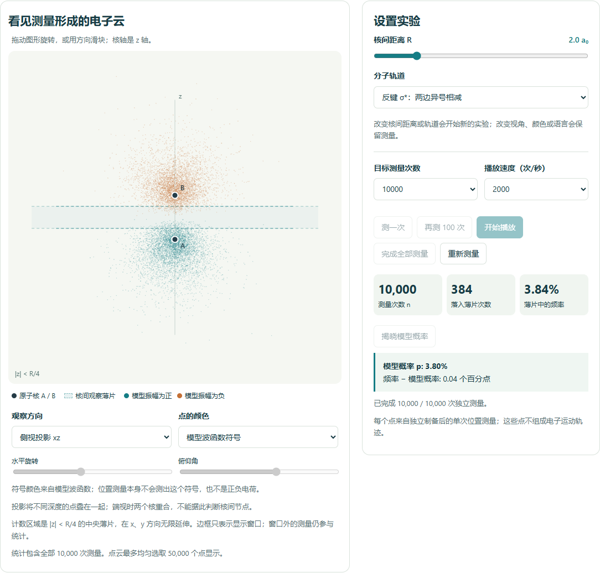

# Quantum Classroom（量子课堂）

**面向大学课堂的概率论、原子轨道与分子轨道互动教学工具。**

[English](README.md) · [模型说明](docs/MODELS.md) · [参与贡献](CONTRIBUTING.md)

一次测量得到一个点，许多次独立测量逐渐呈现概率分布。

本项目在 AI 辅助下开发。学生可以先预测，再模拟位置测量，比较实验频率与模型概率，最后解释观察到的现象。现有网页版支持中英文，完全在浏览器中运行，可离线使用；另提供原生 Python 原子轨道与 H₂⁺ 桌面实验。



## 直接使用

1. 在仓库页面选择 **Code → Download ZIP**，下载并解压；也可以用 Git 克隆仓库。
2. 用较新的 Edge、Chrome 或 Firefox 打开 **[index.html](index.html)**。
3. 点击顶部的 **原子轨道** 或 **分子轨道 · H₂⁺**，通过 **中文 / English** 切换语言。

使用软件不需要安装依赖、登录账户、启动服务器或联网。`electron-cloud-classroom.html` 是同一款独立应用的另一文件名。在 GitHub 页面直接点击 HTML 会看到源码，下载后才能在本地运行。

## 可以探索什么

### Python 桌面预览版 · 原子与 H₂⁺

桌面版提供独立的 NumPy 核心和可选 PySide6 原生界面。已迁移氢原子 1s–4f 共 30 个空间轨道、118 个元素的 Slater 屏蔽单轨道及整个原子球对称混合，同时保留 H₂⁺ 实验。Z=93–118 明确标为理想填充示意，不代表实测基态。切换实验室会暂停测量并保留两边的实验。

两个实验室均支持无截断抽样、全部测量统计、旋转／投影、频率及径向／轴向曲线、中英文与 JSON 导出。第三阶段已加入 5 个双语任务、7 个教师预设、成组重复实验、投影大字模式和完整课堂记录保存／恢复。教师载入不代替学生提交预测，自由解释不自动评分。详见[第三阶段验证记录](docs/PHASE3_VALIDATION.md)与[记录格式](docs/CLASSROOM_RECORDS.md)。

先按[中文安装说明](docs/LINUX_PYTHON.zh-CN.md)或 [English guide](docs/LINUX_PYTHON.md)安装 Linux 系统依赖，然后运行：

```sh
python3 -m venv .venv
.venv/bin/python -m pip install -e '.[desktop,test,gui-test,science-test]'
.venv/bin/quantum-classroom

# 无需显示窗口：
.venv/bin/quantum-classroom-verify
.venv/bin/quantum-classroom-verify-atoms
QT_QPA_PLATFORM=offscreen .venv/bin/python -m pytest tests/python -q
```

实际验证范围与后续工作见[第三阶段验证记录](docs/PHASE3_VALIDATION.md)；第[一](docs/PHASE1_VALIDATION.md)、[二](docs/PHASE2_VALIDATION.md)阶段记录保留为历史说明。

### 现有网页版

| 实验室 | 模型与活动 |
| --- | --- |
| 原子轨道 | 1s–4f 共 30 个氢原子空间轨道；径向分布与节点；屏蔽近似多电子原子；观察球内的测量频率；展示中心极限定理的重复成组实验。 |
| 分子轨道 | 两个固定原子核、一个电子的 H₂⁺；成键 σ 与反键 σ*；可调核间距；波函数符号、干涉及中央薄片频率。 |
| 课堂工具 | “预测—观察—解释”任务、教师预设、投影模式和本地 JSON 学习记录导出。自由解释不自动评分。 |

两个实验室都支持旋转与投影，最多进行 **100,000 次测量**。统计使用全部测量，点云最多选取 50,000 个点显示。切换语言保留实验与答案；切换实验室暂停播放，保留两边的工作状态。

## 第一次课堂演示

1. 进入分子轨道，选择 **任务 A · 一个电子，许多次测量**。
2. 记录预测，先测一次，再逐渐积累更多观察。
3. 揭晓模型概率，与中央薄片中的测量频率比较。
4. 切换反键轨道，完成 **任务 B · 节点与两种颜色**，对照电子云和轴向曲线解释节点。

每个点来自独立制备的同一选定状态的一次位置测量。它们不是电子运动轨迹，也不表示许多电子同时存在。任务中的最低观察次数只是教学门槛，不是保证准确收敛的数学阈值。

网页版的实验和答案保存在页面内存中，刷新或关闭前请导出记录。目前不提供 JSON 导入或进度恢复。软件没有后端；只有主动点击参考资料链接时才会打开外部网站。

## 理解模型的边界

量子模型先给出概率分布。大数定律解释测量频率的趋近，中心极限定理描述适用条件下重复抽样的波动；它们本身不推导波函数或轨道形状。

- **氢原子**：采用非相对论氢样轨道公式；30 个条目是空间轨道，不计自旋。
- **多电子原子**：采用 Slater 屏蔽的类氢教学近似。Z = 1–92 使用参考组态；Z = 93–118 仅为理想填充示意，不代表实测基态组态。本程序不进行自洽电子结构计算。
- **H₂⁺**：采用固定核、两个 1s 轨道线性组合的最小 LCAO 近似。它只有一个电子，与有两个电子的 H₂ 不同。本程序不计算能量、平衡键长或反应动力学。
- **颜色与曲线**：符号颜色表示所选实波函数的正负号，不是电荷，也不是位置测量直接测出的相位。轴向曲线取 x = y = 0 处的值，不是边缘概率分布。

[模型说明](docs/MODELS.md) 中给出了归一化、抽样方法、参考资料，以及零厚度节点平面与有限厚度观察薄片的区别。数值验证检验的是计算与抽样，不代表已经验证了课堂学习效果。

## 开发与验证

可编辑源码在 `assets/` 中。生成的独立 HTML 包含全部脚本和样式，以及本地 D3 副本。

```sh
python assets/build.py
npm test
```

构建需要 Python 3，会重新生成 `index.html` 和 `electron-cloud-classroom.html`。开发环境使用 Node.js 22 或更新版本；核心数学测试不需要安装 npm 依赖。

可选的浏览器检查：

```sh
npm ci
npx playwright install chromium
npm run test:browser
```

可选的独立数值检查：

```sh
python -m pip install numpy
python assets/verify_molecular_independent.py

# 氢原子独立检查还需要 SciPy。
python -m pip install scipy
python assets/verify_independent.py
```

分子独立检查在柱坐标中直接积分三维密度，与程序内部的概率化简方法相互独立。其他检查覆盖归一化、节点、可重复抽样、矩和测量频率。

检查已提交的 HTML 是否与源码一致，并生成供师生使用的离线 ZIP：

```sh
python assets/build.py --check
python scripts/package_release.py
```

`dist/` 中的 ZIP 包含独立应用、文档和许可声明。可编辑源码和开发测试请从仓库克隆或下载。`artifacts/` 测试输出和课堂导出记录不会进入 Git。

## 参与项目

欢迎提出教学案例、解释改进、翻译、无障碍体验和模型修正。请阅读 [CONTRIBUTING.md](CONTRIBUTING.md)，或通过问题模板提交反馈与教学想法。

## 许可证

项目代码和文档采用 [MIT 许可证](LICENSE)。随项目分发的 D3 及其所含依赖保留各自许可声明，见 [THIRD_PARTY_NOTICES.md](THIRD_PARTY_NOTICES.md)。
