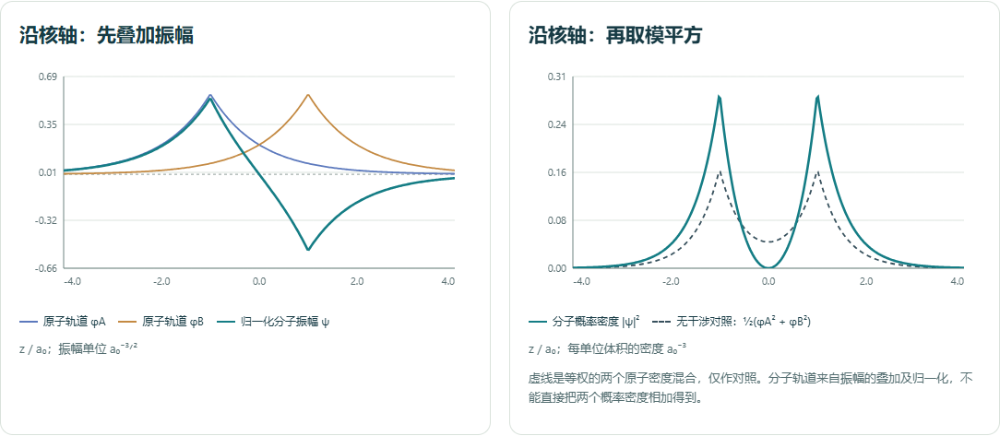

# Models and interpretation

[English overview](../README.md) · [中文介绍](../README.zh-CN.md)

This page describes the distributions sampled by the program. Numerical agreement with these distributions validates the implementation, not the exactness of each physical approximation.

## Measurements and probability

The model supplies a normalized position density, usually written as $|\psi|^2$. Each dot is sampled independently from a newly prepared system in the same selected state. Accumulating dots displays the distribution of repeated position measurements.

The law of large numbers explains convergence of the observed frequency for a fixed region and distribution. It does not imply that the error decreases at every step, or that a chosen sample size guarantees exact agreement thereafter. The atomic laboratory's repeated-group experiment illustrates the central limit theorem for the frequency of a region event, subject to the usual sample-size and probability conditions.

Neither theorem derives the wavefunction. The points are not consecutive positions on an electron path. Sign colors are labels computed from the chosen real wavefunction, not signs of electric charge or phases directly measured by position observations. Replacing $\psi$ with $-\psi$ changes those labels but leaves every position probability unchanged.

## Hydrogen spatial orbitals

The atomic engine uses the nonrelativistic hydrogen radial functions and a real spherical-harmonic basis. The interface includes 30 spatial orbitals in the first four shells, from 1s through 4f; spin is not counted. Additional hydrogen orbitals exist beyond this catalog.

For principal quantum number $n$ and angular quantum number $l$, the model has $n-l-1$ radial nodes and $l$ angular nodes. A pointwise spatial density and a radial probability density are different: the latter includes the spherical-shell volume factor. An axis or radial plot should be interpreted using its displayed quantity and units.

References:

- [NIST DLMF: hydrogen radial wavefunctions](https://dlmf.nist.gov/18.39#E37).
- [NIST DLMF: spherical harmonics](https://dlmf.nist.gov/14.30).

## Screened multi-electron atoms

The program applies Slater shielding rules to obtain an effective nuclear charge and scales hydrogenic orbitals accordingly. This retains their characteristic angular shapes and nodes, but is not a self-consistent-field solution and does not calculate electron correlation or relativistic effects.

Configurations for Z = 1–92 use reference neutral-atom configurations. For Z = 93–118, configurations are ideal-filling illustrations and must not be interpreted as observed ground states.

The whole-atom view is an electron-count-weighted mixture of occupied-subshell position densities, angularly averaged within subshells. It is not one coherent wavefunction, so it has no shared wavefunction-sign coloring. Each sample in that view represents measuring one randomly selected electron from a newly prepared atom.

References:

- [Slater, Atomic Shielding Constants (1930)](https://harvest.aps.org/v2/journals/articles/10.1103/PhysRev.36.57/fulltext).
- [NIST reference neutral-atom configurations](https://math.nist.gov/DFTdata/atomdata/configuration.html).

## H₂⁺: two centers and one electron

The molecular laboratory describes H₂⁺, which contains two protons and one electron. It does not model the two-electron H₂ molecule.

The nuclei are fixed on the z axis at $z=-R/2$ and $z=+R/2$. Lengths are expressed in Bohr radii $a_0$ (about 0.0529 nm); formulas below use atomic units. The supported separation is $0.6\leq R\leq8$.

Using two unoptimized hydrogen 1s functions,

$$
\phi_A=\frac{e^{-r_A}}{\sqrt{\pi}},\qquad
\phi_B=\frac{e^{-r_B}}{\sqrt{\pi}},
$$

the overlap is

$$
S=e^{-R}\left(1+R+\frac{R^2}{3}\right).
$$

The two normalized linear combinations are

$$
\psi_\pm=\frac{\phi_A\pm\phi_B}{\sqrt{2(1\pm S)}}.
$$

The program labels these bonding σ and antibonding σ*, respectively, and samples $|\psi_\pm|^2$. Amplitudes are combined before squaring, so the density contains an interference term. Adding atomic densities alone does not produce the same result.

The probability plot also shows the normalized no-interference reference

$$
q=\tfrac12\left(\phi_A^2+\phi_B^2\right).
$$

This is an equal-weight mixture used for comparison, not the selected molecular orbital's density.

This minimal LCAO model is a fixed-nuclei teaching approximation, not an exact solution of the two-center Schrödinger equation. The 1s exponents are not variationally optimized. The program does not calculate energies, equilibrium bond lengths, bond energies, nuclear motion, or reaction dynamics. Changing R selects another fixed geometry; it does not simulate a vibrating or dissociating molecule.

The derivation and overlap normalization follow the [University of Texas quantum-mechanics notes, Hydrogen Molecule Ion, equations 9.98–9.107](https://farside.ph.utexas.edu/teaching/qm/Quantum/node100.html). For an introductory discussion of bonding and antibonding combinations, see [OpenStax Chemistry 2e, section 8.4](https://openstax.org/books/chemistry-2e/pages/8-4-molecular-orbital-theory).

### Observation slab and nodal plane

The counted region is the central slab $|z|<R/4$, with no limit in x or y. Its model probability is the three-dimensional integral of the selected density over that region. At R = 2, the model probabilities are approximately 25.948% for the bonding combination and 3.795% for the antibonding combination.

The antibonding wavefunction cancels exactly on the zero-thickness plane z = 0. That nodal plane has zero density. The surrounding finite-thickness observation slab still has nonzero probability and may contain measurement points. Finite random samples, including an empty-looking region, cannot establish an exact node by themselves.

The slab widens when R increases. Its frequency therefore is not a direct measure of bond strength when comparing different separations.

### Curves and projections

The axial plots evaluate the wavefunction or spatial density at x = y = 0. They are not the z marginal obtained by integrating over x and y. The area under an axial point-density curve is not the displayed slab probability.

Projections overlap points at different depths. In the xy end projection, both nuclei coincide and the midpoint nodal plane cannot be identified from the cloud alone. Use other views and the model curves to interpret the structure.

## Sampling, display, and checks

The molecular engine uses a mixture of the two normalized 1s densities as a rejection-sampling proposal. Sampling has no drawing-box cutoff. Seeds make samples reproducible, including their prefixes when the target count changes. Region probability is evaluated deterministically, separately from the measured sample frequency.

The numerical tests check normalization, overlap, symmetries, nodes, sample frequencies, moments, and reproducibility. An optional Python check directly integrates the molecular density in cylindrical coordinates, independently of the JavaScript engine's probability reduction, and checks expanded integration bounds and quadrature orders.

Both laboratories include all measurements in their statistics, up to 100,000. The cloud selects at most 50,000 measurement indices for display; clipping and projection do not remove samples from the statistics.

## Python atomic implementation (phase 2)

The Python core preserves the web orbital IDs, real-harmonic sign convention,
Slater rules and neutral configurations. `HydrogenOrbital` implements the finite
Laguerre polynomial and associated Legendre recurrence using NumPy. The 30
hydrogen classroom states have n<=4; internal n<=7 s/p/d/f states support the
screened model. SciPy is used only as an independent verification reference.

For radial-node states, rejection uses constant envelopes on scaled-radius
intervals of width 0.125, evaluated at endpoints and polynomial critical points.
The tail starts at T=max(40,8n+16) in rho=2 Z_eff r/n and has an exponential
envelope with rate 1-(2n)/T. Bounding Laguerre coefficients by their absolute
values makes this envelope extend to infinity. States without radial nodes use
an exact Gamma proposal. Uniform spherical angular rejection is bounded by the
real-harmonic addition theorem. Independent fixed-block streams preserve sample
prefixes across arbitrary chunk sizes. Sampling never uses the drawing extent.

Sphere probabilities use 32-point Gauss-Legendre integration on panels no wider
than one scaled-radius unit. As in the web engine, the CDF integral ends at
rho=160 when a larger radius is requested; the omitted tail is negligible at the
documented 2e-11 verification tolerance. This numerical CDF bound is not a
sampling cutoff. Independent quadrature also checks normalization and moments
over an infinite radial interval.

Whole-atom sampling chooses a subshell with probability electrons/Z, then samples
its screened radius and a uniform direction. This directly implements the web
model's complete-angular-basis average, including open subshells; it is not an
oriented many-electron wavefunction. Its density is the weighted radial-amplitude
square divided by 4pi, including a finite evaluation at the origin. There is no
common amplitude or phase, and the desktop disables sign colors in this mode.

The independent offline NIST test fixture contains expanded neutral occupancies
for H–U from the [reference table](https://math.nist.gov/DFTdata/atomdata/configuration.html),
retrieved 2026-11-03. Only factual occupancies are recorded. Z=93–118 continue to
use ideal filling, never an observed-ground-state label.

## Python H₂⁺ implementation (phase 1, preserved)

`src/quantum_classroom/core/molecular.py` implements the same fixed-nuclei 1s LCAO
model, R range and infinite transverse slab as the web engine. Near the node it
uses `rA-rB = 2Rz/(rA+rB)` and `expm1` to avoid subtracting nearly equal
exponentials. Slab probability uses the existing prolate-coordinate reduction
with a 128-node Gauss-Legendre residual integral, checked by independent direct
cylindrical integration. The residual beyond u=40 contributes less than 1e-18
within the supported R interval; sampling itself has no finite spatial boundary.

The proposal is the equal-weight mixture of two 1s densities. Radii follow
Gamma(shape=3, rate=2), directions are isotropic, and rejection gives the selected
normalized molecular density. NumPy PCG64 proposals are generated in fixed blocks
of 4096; accepted leftovers are retained across `take` calls. The reported
acceptance count includes that buffer, while measurement counts include only
delivered samples. Python and JavaScript RNGs intentionally differ. Fixed-seed
tests compare within-language prefixes; cross-language checks compare amplitudes,
overlap, slab probability and axis curves, while statistical tests compare to the
same model integrals and moments.

`quantum-classroom-verify` checks numerical normalization and sampling without Qt,
Node or a display. See [Linux/Python documentation](LINUX_PYTHON.md) for commands,
statistical tolerances, display limits and current validation scope.

## Classroom records (web edition)

Choice answers can be checked against the stated model explanation. Free-written explanations are not automatically graded. Activity observation minima are practical teaching requirements, not mathematical convergence guarantees.

Current answers and experiment data live in page memory. JSON export saves a local record; it does not upload the record, and there is currently no import or restoration feature. Teaching activities and numerical checks are not evidence of measured classroom learning gains.

## Python classroom activities and records (phase 3)

The native edition now includes five bilingual tasks and seven teacher presets,
plus complete local save/restore; see the [record contract](CLASSROOM_RECORDS.md).
Teacher loading resets only the chosen experiment and never submits a student
prediction. A recorded prediction is tied to a unique experiment run, so resetting
with the same seed cannot reuse an earlier observation. Changing language keeps
answers and the probability reveal state. Free explanations remain ungraded.

For grouped region events, the selected quantum model supplies p first. The core
draws independent K_j ~ Binomial(n,p), with f_j=K_j/n,
E[f_j]=p and Var(f_j)=p(1-p)/n. These are equivalent region hit counts, not newly
generated xyz measurements, and do not change the position experiment. The
standardized error is (f_j-p)/sqrt(p(1-p)/n), undefined for p=0 or 1.
The normal overlay is an approximation; a warning when min(np,n(1-p))<10 is a
conservative teaching heuristic, not a bound on approximation error. Finite
histograms need not be smooth. Neither LLN nor CLT supplies a wavefunction.
